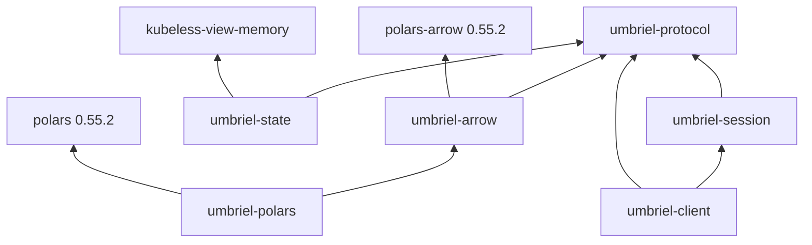

# Implemented ownership and data paths

**The design is a checked wire core, a separately owned connection, and optional
consumers.** Six crates keep protocol, runtime, observation, and columnar work
independently usable. Sonic is the JSON backend. Polars-native Arrow is the
columnar representation; the product has no C Data Interface bridge.

This supersedes [architecture1](architecture1.gpt6a.md) as the current account.
It describes implementation through `c7de1de4`, not just an intended layout.
The [README](../../README.md) is the usage entry point; the crate READMEs and
source own detailed API contracts.

## Terms that carry a contract

| Term | Meaning here |
|---|---|
| Frame | One LF-delimited wire unit; the codec exposes bytes without LF, including a possible empty frame. |
| Family snapshot | Complete replacement state for one event family, not a patch or a complete transition history. |
| Observation | A local epoch announcement, positioned frame, or source gap delivered to an observer. |
| Epoch / position | Checked local connection lineage / receive order, not server revisions or resumable cursors. |
| Wire slot | Ownership of one request's outbound bytes and eventual reply, independent of its waiting caller. |
| Materialized state | An optional maintained local view of separately observed family snapshots. |
| Complete replacement | Meaning carried by an input batch envelope, including when its row count is zero. |
| Derived result | Output of a lazy query; it retains input provenance without claiming to be the original full family. |

## Crate graph

Solid arrows mean normal dependencies. Example composition adds development
dependencies without pulling transport or the query engine into lower layers.



| Crate | Native responsibility |
|---|---|
| [`umbriel-protocol`](../../crates/umbriel-protocol/README.md) | Framing, checked Sonic decoding, envelopes, complete payload models, query requests, and 121 typed action paths. |
| [`umbriel-session`](../../crates/umbriel-session/README.md) | Clock-free connection roles, one request slot, write accounting, reply routing, cancellation and terminal facts. |
| [`umbriel-client`](../../crates/umbriel-client/README.md) | Tokio Unix discovery/I/O, source task, bounded command admission and observers, deadlines and explicit reconnect policy. |
| [`umbriel-state`](../../crates/umbriel-state/README.md) | Family inventories, coherent local captures/joins, freshness and gap handling, and the pure active-identity dwell reducer. |
| [`umbriel-arrow`](../../crates/umbriel-arrow/README.md) | Owned windows/workspaces columns and schema-checked complete-replacement envelopes. |
| [`umbriel-polars`](../../crates/umbriel-polars/README.md) | Native lazy expressions, explicit finite collection, and provenance-preserving derived batches. |

Action families are modules, not crates. Dwell and inventories share the state
crate. Generic caller provenance avoids a tiny shared-metadata package. The
native examples compose these boundaries instead of creating a second client
or a general stream framework.

The user-approved Kubeless dependency is the sibling checkout's narrow
`view/memory` leaf at version `0.1.0`. It is a local development dependency, not
a registry publication or a pinned remote. The current leaf is used directly;
the old assessment's package graph is historical.

## Wire core: predictable work and explicit lifetimes

`Framer` owns contiguous reusable byte storage. `push` validates incoming frame
and buffered-byte limits before changing storage, then copies the supplied bytes.
A scan cursor avoids repeatedly scanning a fragmented prefix. Complete frames
borrow the allocation; compaction moves only the unconsumed tail. Consumption
retains capacity. Accepting a maximal payload also requires room for its LF.

Incoming bounds are client policy. The server's outgoing request constraint is
separate: **65,536 bytes including LF**, enforced by the encoder. Encoding replaces
caller storage, clears it on failure, and retains its capacity. The bounded sink
limits the wire result, not all temporary memory inside Sonic's serializer.

`codec::decode<T>` accepts caller-selected Serde types. UTF-8 is checked before
Sonic's lazy-string path; typed parsing checks structure and trailing input.
Only actual Unicode-escaped tokens receive supplementary hex/surrogate checks
for the inspected Sonic 0.5.10 gap. Arbitrary caller `Deserialize` code can run
before those checks finish, so stateful consumers stage changes until success.

The borrowed `Message` envelope preserves `Ok`, `Err`, `Event` and `Blank`:

- `ok:null` is present successful data, not a missing reply.
- Significant duplicate/conflicting keys fail; additive fields are validated.
- Key order is unrestricted. Current compositor `data` precedes `event`.
- Unknown families preserve their names and raw payloads.
- Unescaped data can borrow; escaped retained strings may need owned storage.
- An empty frame is contextual input, never a fabricated successful command.

Owned models serve normal application storage. Borrowed custom projections remain
available without forcing an owned inventory. Serde `Cow` fields need deliberate
`#[serde(borrow)]` annotations; plain `Cow` defaults to owned deserialization.
Known model enum spellings now classify without a transient owned string, while
unknown spellings retain their exact owned text.

Typed actions prepare immutable text once. Bare actions borrow static spellings;
parameterized families validate and format once, then `Action::request()` borrows
that text into the ordinary `msg` encoder. The catalog covers 95 bare and 26
parameterized paths. Local syntax checks do not establish target existence,
current focus, layout applicability, or execution success. Raw actions retain
an explicit escape hatch and still receive JSON escaping and byte bounds.

## Request path: custody survives the waiter

```text
typed or raw request
  -> checked encoding / PreparedCommand
  -> bounded client admission
  -> the session's single wire slot
  -> accounted partial writes
  -> validated native reply
  -> raw reply or caller-selected result decode
```

`Session::admit` reuses outbound storage for direct sans-I/O callers.
`PreparedCommand` lets the client validate/encode before queue admission and
transfer checked storage without a raw-byte bypass or another encoding pass.
Neither path permits an ordinary request to smuggle in `subscribe`.

The roles follow the compositor:

| Role | Lifecycle |
|---|---|
| One-shot | Fresh connection, one request, one native reply, clean EOF. No idle pool or second request. |
| Subscription | Initial subscribe, matching-event or keyboard-only-blank acceptance, then events and sequential ordinary replies. |

There are no wire IDs. A local ID tracks ownership but cannot manufacture
correlation. At most one ordinary request is outstanding. Extra replies without
a slot fail; a duplicate old reply after a later request has been fully written
is inherently indistinguishable without upstream correlation support.

The client semaphore covers **ingress + queued + active/draining commands**.
Cancelling an unsent request withdraws it. After possible transmission, the old
slot remains owned until its reply drains or the connection closes. A partial
request still needs its suffix written or the socket retired. Caller cancellation
does not imply execution reversal.

Queued deadlines expire unsent. Active deadlines close the connection; cancelled
sent commands receive a bounded drain interval before closure. A one-shot
reply-then-EOF timeout records both observed reply and possible transmission.
Unexpected local driver loss has its own outcome; it is not evidence that an
admitted command was unsent. Remote rejection, protocol failure, payload decode
failure and transport uncertainty remain distinct.

Native `ok` acknowledges the action's protocol boundary. It does not certify
rendering or geometry convergence, and a local view anchor cannot supply a
server-side compare-and-swap precondition.

## Subscription owner and independent delivery

One spawned Tokio task owns the socket, framer and session. Waiting callers and
observers do not drive wire progress. The initial observer is installed before
reading, so initial snapshots are retained. Later observers begin at registration;
they receive no invented seed or history.

The driver processes bounded frame turns and readiness-based `try_read` /
`try_write`. Write attempts resolve synchronously through the session before
reply routing. It retires observers in place, preserves the command queue's
storage and FIFO survivors, and publishes status changes only when represented
health/readiness changes.

Observer intervals have independent item and logical-byte budgets. Raw frame
bytes are copied once into shared `Arc<[u8]>` storage for asynchronous delivery;
observers share that storage rather than each building a JSON tree. Shared bytes
are conservatively charged in full per observer. This is queue accounting, not
unique resident-memory measurement. Caller-retained frames are caller storage.

One stalled observer retires with explicit lag and does not block other observers
or command replies. Already queued observations drain before the first retained
terminal. The terminal is kept outside queue capacity. Unexpected producer loss
becomes `DriverLost`, not a consumer panic or an invented native terminal.
`try_recv` distinguishes temporarily empty from ended; `message()` is fallible
even for caller-constructed observations.

Dropping the last `Subscription` owner initiates closure. Observers and status
watchers do not prolong socket ownership. Explicit `shutdown` affects all source
clones and waits for cleanup. Status is a latest/historical view, not a log of
every transition; observation intervals carry positioned frames and explicit loss.

## Initialization, reconnect and ordering evidence

The subscription family set is fixed. There is no universal completion marker:
keyboard state can remain unseen indefinitely, and keyboard-only acceptance can
be a bare LF. Readiness is per family and reflects envelope observation; typed
payload validation belongs to its consumer.

Initial and repeated-subscribe snapshots can duplicate broadcast state. The
server also coalesces intermediate changes. Receive positions count connection-
local frames, including replies that an event observer does not receive; gaps in
a selected sequence therefore do not prove loss.

Reconnect defaults to `Never`. Selected retries handle EOF/transport loss, open
a fresh socket, resubscribe and advance a checked local epoch. Observers receive
gap then epoch evidence, or an explicit terminal if they cannot retain it.
Family readiness resets. Commands bound to an old epoch are rejected; actions
are never replayed automatically. Protocol failure and deadline-driven closure
do not silently enter transport-retry policy.

## Optional observed state

`Inventory` uses one Kubeless replacement map per complete family. Private
reader/writer handles preserve association between installed membership, source
order and source status. Empty arrays install known empty relations; nullable
submap is known data. Duplicate/empty keyed IDs fail before membership changes,
without narrowing the raw protocol decoder's representation.

A rejected attempt and the last installed snapshot have distinct evidence.
Gaps and epoch changes leave retained rows explicitly stale. A transport/interval
gap requires a newer epoch before installation resumes; a later valid complete
family snapshot can repair a family-specific invalid-snapshot state.

`snapshot()` captures the serialized owner coherently. Membership and order are
read-only in the capture; lexical keyed iteration and compositor array order
are separate. Joins retain every window, explicitly distinguish scratchpad,
empty and unmatched workspace references, and carry **both** family stamps.
Local capture coherence does not make the two compositor observations atomic.

`StableActiveReducer` is independent of sockets and clocks. It selects `active`,
not workspace-local `focused`, and receives monotonic time explicitly. The
default 750 ms deadline tracks identity rather than silence: title/geometry
churn does not postpone it; A–B–A starts a new A episode. Valid no-active data
can emit stable `None`, while loss invalidates continuity. Timer-only progress
can emit, once per qualifying episode.

The native example drains queued input before testing a due deadline and yields
without publishing if its work budget is exhausted. It measures continuity of
observed identity, not physical transitions hidden by compositor coalescing.

## Polars-native columnar path

```text
complete protocol rows
  -> owned Utf8View / Int32 / Boolean columns
  -> SnapshotBatch<caller provenance> (complete replacement)
  -> DataFrame -> LazyFrame -> caller expressions
  -> explicit blocking collect
  -> QueryResult<caller provenance> (derived native batches)
```

`umbriel-arrow` depends on standalone `polars-arrow`, not the query engine or
state store. `umbriel-polars` adds the facade. Both select matching `=0.55.2`
types and expose the native namespaces so callers need not guess compatible
versions. There is no Apache Arrow/C Data Interface conversion in the product.

The emitter owns all buffers and retains all wire fields for windows/workspaces.
It checks names, counts, heights, dtypes and nullability before exposing an
immutable `SnapshotBatch`. This matters because upstream `RecordBatch::try_new`
does not check all dtype invariants assumed by `DataFrame::from`. Arbitrary raw
batches cannot enter our convenience conversion as if they had that proof.

Replacement metadata sits outside rows and survives zero-row snapshots. Finite
queries produce explicitly derived output, even if they filter everything out.
Input provenance survives; additional joined inputs require caller-managed
provenance. A LazyFrame is a plan over supplied data, not a live incremental view.

Collection/rechunking can allocate and currently returns one owned native batch.
The native example runs one blocking query worker at a time, sends each result
to a sink, and retains no output history. Socket driving remains independent.
Observer bounds do **not** bound arbitrary query-engine temporaries or amplified
result sizes; those require an application query/execution policy.

## Performance evidence and next questions

The [corrected baseline](../performance/bench0.glm53m.md) measures protocol work
on sanitized live-shape and scaled synthetic fixtures. Reused framing has zero
steady-turn allocator calls while still copying incoming bytes. The portable
x86-64 build uses SSE2; a native AVX2 comparison is a separate experiment.

Two established improvements are deliberately narrower than a throughput claim:

- Correct borrowing annotations reduced the live selected projection from
  62 allocator calls to 4, with escaped synthetic strings still owned as needed.
- [Known-enum classification](../performance/enum-allocations0.gpt61s.md) reduced
  the 29-window owned-model paths from 149 calls to 120, preserving wire semantics.

The lazy-envelope-plus-model path still performs envelope validation followed
by payload decoding. Single-pass contextual typed decoding is a plausible next
experiment, but must handle data-before-event ordering, unknown families,
interleaved replies and complete validation. A direct payload benchmark is not
an equivalent whole-envelope contract or proof of an achievable fused cost.

The [Kubeless asks](../kubeless/asks0.gpt61s.md) identify a different reuse
opportunity: a small independent, byte-bounded, terminal-retaining delivery cell
with a real tmux second consumer. Existing memory-view reuse is appropriate.
Ordered inventory/source policy, the wire slot, window dwell and Polars schemas
remain native; broader lifts require a concrete simplification and compatibility
evidence, not merely another generic package.

## Verification and navigation

The assembled implementation passed **152 tests, six doctests, formatting and
all-targets Clippy with warnings denied**. Tests include scripted Unix peers,
partial writes, cancelled/late replies, slow observers, reconnect epochs,
Unicode/limits, all action paths, state replacement, timer precedence and native
Polars composition. Agent checks and parent integration checks are distinguished
in the linked reports and session provenance.

- [Usage and commands](../../README.md)
- [Protocol catalog](../protocol/commands0.glm53m.md) plus [governing corrections](../protocol/review0.gpt6a.md)
- [Action starter and handoff](../protocol/actions-handoff0.gpt61s.md)
- [Performance baseline](../performance/bench0.glm53m.md) and [allocation addendum](../performance/enum-allocations0.gpt61s.md)
- [Kubeless asks and lift boundaries](../kubeless/asks0.gpt61s.md)
- [Predecessor architecture](architecture1.gpt6a.md) and [earlier dwell rationale](architecture0.gpt6a.md#stable-active-window)
